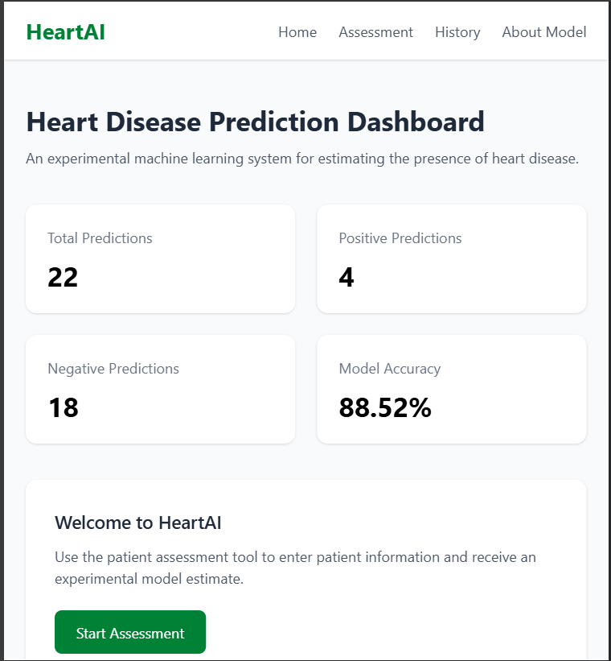
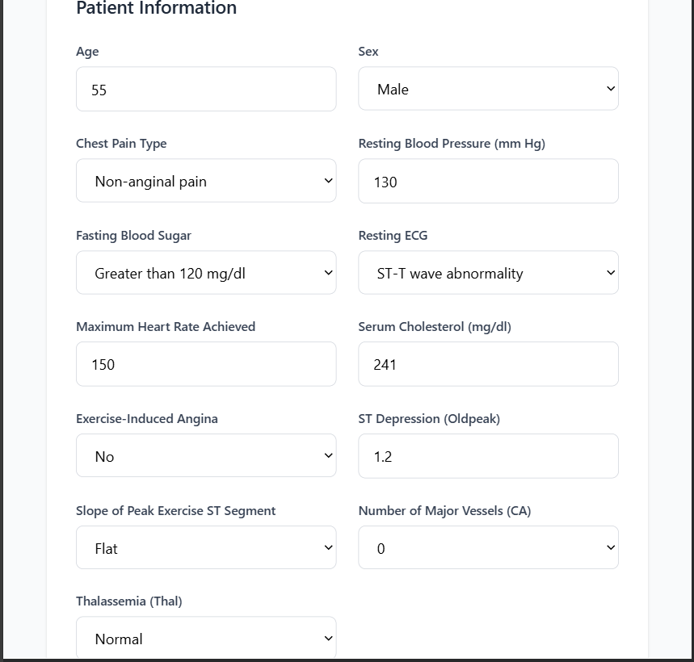
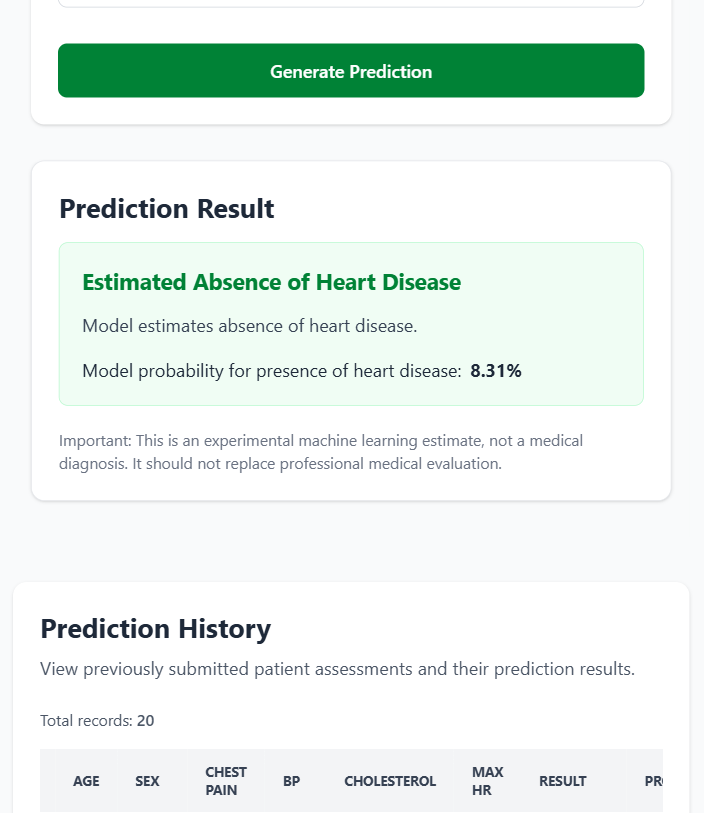
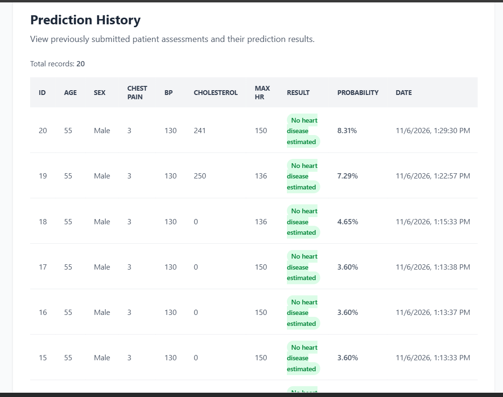
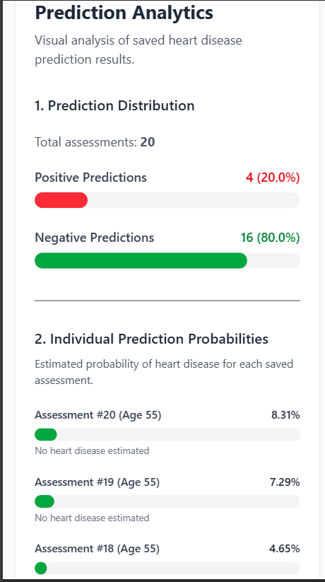
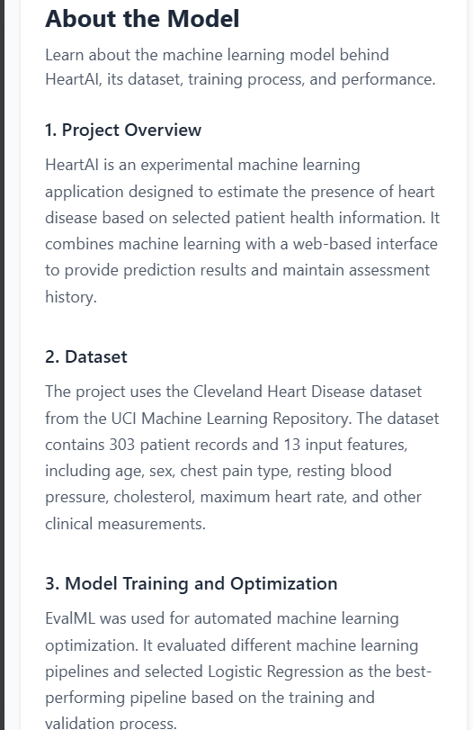

# ❤️ HeartAI – Heart Disease Prediction System

An AI-powered web application that estimates the presence or absence of heart disease using patient health information and a machine learning model optimized with EvalML.

## 📌 Project Overview

HeartAI is a full-stack machine learning application designed to demonstrate how artificial intelligence can support the analysis of cardiovascular health data.

Users can enter patient health measurements through a web-based assessment form. The trained machine learning model analyzes the information and returns a prediction together with its estimated probability.

The application also provides prediction history, analytics, and information about the machine learning model.

**Important:** This project is for educational and research purposes only. It is not a medical diagnostic tool and must not be used to make medical decisions.

## ✨ Features

- **Patient Assessment:** Enter 13 health-related features.
- **Heart Disease Prediction:** Estimate the presence or absence of heart disease.
- **Prediction Probability:** Display the model's estimated probability.
- **Prediction History:** Store and review previous predictions.
- **Analytics Dashboard:** Visualize prediction statistics and distributions.
- **Model Information:** View details about the dataset, algorithm, and evaluation results.
- **Responsive Interface:** Access the application through desktop and mobile-sized screens.
- **REST API:** Connect the React frontend to the FastAPI backend.

## 🛠️ Technologies Used

| Area | Technologies |
|---|---|
| Frontend | React.js, JavaScript, Tailwind CSS |
| Frontend tooling | Vite |
| Backend | Python, FastAPI |
| Database | PostgreSQL |
| Machine Learning | EvalML, Scikit-learn |
| Model Storage | Joblib |
| Data Processing | Pandas, NumPy |
| API Communication | REST API |

## 🧠 Machine Learning

### Dataset

The project uses the Cleveland Heart Disease dataset from the UCI Machine Learning Repository.

- Original dataset records: 303
- Input features: 13
- Target variable: Heart disease presence or absence
- Missing values: Handled using most-frequent-value imputation
- Train-test split: 80% training and 20% testing
- Random state: 42
- Splitting strategy: Stratified sampling

The original target values were converted into two classes:

- `0`: Absence of heart disease
- `1`: Presence of heart disease

### Input Features

The model uses the following 13 features:

| Feature | Description |
|---|---|
| age | Age of the patient |
| sex | Patient sex (dataset encoding) |
| cp | Chest pain type |
| trestbps | Resting blood pressure |
| chol | Serum cholesterol |
| fbs | Fasting blood sugar greater than 120 mg/dl |
| restecg | Resting electrocardiographic results |
| thalach | Maximum heart rate achieved |
| exang | Exercise-induced angina |
| oldpeak | ST depression induced by exercise relative to rest |
| slope | Slope of the peak exercise ST segment |
| ca | Number of major vessels colored by fluoroscopy |
| thal | Thalassemia category |

### Model Optimization

EvalML was used to automate the machine learning model search and optimization process.

The best-performing pipeline selected for this project was:

**EvalML Logistic Regression**

The final pipeline was evaluated on the held-out test dataset.

### Model Performance

| Evaluation Metric | Score |
|---|---:|
| Accuracy | 88.52% |
| Precision | 83.87% |
| Recall | 92.86% |
| F1-score | 88.14% |
| ROC-AUC | 96.32% |

These results represent performance on the project's test split and do not establish clinical effectiveness.

## 📊 Model Evaluation Visualizations

### 1. Confusion Matrix

The confusion matrix shows the number of correct and incorrect predictions for each class.


Test-set confusion matrix:

| | Predicted: No Disease | Predicted: Disease |
|---|---:|---:|
| Actual: No Disease | 28 | 5 |
| Actual: Disease | 2 | 26 |

### 2. Precision-Recall Curve

The Precision-Recall curve illustrates the relationship between precision and recall at different classification thresholds.


### 3. ROC Curve

The Receiver Operating Characteristic (ROC) curve illustrates the model's ability to distinguish between the two classes at different classification thresholds.

**ROC-AUC: 96.32%**


## 🖥️ Application Screenshots

### Homepage



### Patient Assessment



### Prediction Result



### Prediction History



### Analytics Dashboard



### About Model



## 🏗️ Project Architecture

The application follows a full-stack architecture:

1. **React Frontend:** Collects patient information and displays predictions.
2. **FastAPI Backend:** Receives requests, validates input, and communicates with the machine learning pipeline.
3. **Machine Learning Pipeline:** Processes patient features and generates predictions.
4. **PostgreSQL Database:** Stores prediction records and related information.
5. **Analytics:** Retrieves stored records and calculates prediction statistics.

## 📁 Project Structure

```text
heart-disease-prediction/
│
├── backend/
│   ├── app/
│   │   ├── api/
│   │   ├── core/
│   │   ├── database/
│   │   ├── models/
│   │   ├── schemas/
│   │   └── services/
│   └── tests/
│
├── frontend/
│   ├── src/
│   │   ├── components/
│   │   ├── context/
│   │   ├── hooks/
│   │   ├── layouts/
│   │   ├── pages/
│   │   ├── services/
│   │   └── utils/
│   └── package.json
│
├── machine_learning/
│   ├── data/
│   │   ├── raw/
│   │   └── processed/
│   ├── models/
│   ├── notebooks/
│   ├── reports/
│   │   └── figures/
│   └── src/
│       ├── evaluation/
│       ├── explainability/
│       ├── preprocessing/
│       └── training/
│
├── docs/
│
├── screenshots/
│
├── README.md
└── requirements.txt
```

## ⚙️ Installation and Setup

### Prerequisites

Make sure you have installed:

- Python 3.11
- Node.js and npm
- PostgreSQL
- Git

### 1. Clone the Repository

```bash
git clone YOUR_GITHUB_REPOSITORY_URL
cd heart-disease-prediction
```

### 2. Set Up the Backend

Create and activate a Python virtual environment:

**Windows PowerShell**

```powershell
python -m venv venv
.\venv\Scripts\Activate.ps1
```

Install the Python dependencies:

```powershell
pip install -r requirements.txt
```

Configure your PostgreSQL database connection using the environment variables required by the backend configuration.

Make sure the PostgreSQL database is running and the database exists before starting the backend.

Start the FastAPI server from the project root:

```powershell
python -m uvicorn backend.app.main:app --reload
```

Backend address:

`http://127.0.0.1:8000`

API documentation:

`http://127.0.0.1:8000/docs`

### 3. Set Up the Frontend

Open another terminal and navigate to the frontend directory:

```powershell
cd frontend
```

Install dependencies:

```powershell
npm install
```

Start the development server:

```powershell
npm run dev
```

Frontend address:

`http://localhost:5173`

## 🔌 API Endpoints

The backend provides REST API endpoints for application functionality.

| Method | Endpoint | Description |
|---|---|---|
| GET | `/health` | Check backend health |
| GET | `/` | Root endpoint |
| POST | `/api/v1/predictions/` | Generate a prediction |
| GET | `/api/v1/predictions/history` | Retrieve prediction history |
| GET | `/api/v1/predictions/statistics` | Retrieve prediction statistics |

Interactive API documentation is available through FastAPI Swagger UI:

`http://127.0.0.1:8000/docs`

## 🔒 Disclaimer

HeartAI is an academic machine learning project developed for educational and research purposes.

The system uses a historical dataset and provides experimental predictions based on learned statistical patterns. Its outputs are not clinically validated and should not be interpreted as a medical diagnosis, a prediction of an individual's future heart attack, or a substitute for professional medical advice.

## 🚀 Future Improvements

- Explore additional machine learning algorithms.
- Improve model generalization using larger and more diverse datasets.
- Add explainable AI features to help interpret model predictions.
- Improve model monitoring and performance evaluation.
- Enhance application security and user authentication.
- Deploy the application to a cloud platform.

## 👨‍💻 Author

**Miruk Yilikal**

Electrical and Computer Engineering Student  
Addis Ababa University

GitHub: [Your GitHub Profile](YOUR_GITHUB_PROFILE_URL)

## 🙏 Acknowledgements

- UCI Machine Learning Repository for providing the Cleveland Heart Disease dataset.
- EvalML for automated machine learning optimization.
- FastAPI, React, and the open-source Python ecosystem for the development tools used in this project.

---

⭐ If you find this project interesting, consider giving it a star on GitHub.
